# Open-Loop-Flyback-Convertor
Design and simulation of an isolated DC-DC Flyback convertor in open loop with and without RCD snubber circuit to understand all different aspects of design.

## Design Specifications
Input = 325V (DC) 
Output = 12V (DC) 
Output power = 24W 
Output current = 2A 
Switching frequency = 65 KHz 
Target efficiency = 85% 
Regulation = ±5% 

## SCHEMATICS
Open-Loop isolated flyback convertor with RCD clamp(left) and without RCD clamp(right).

  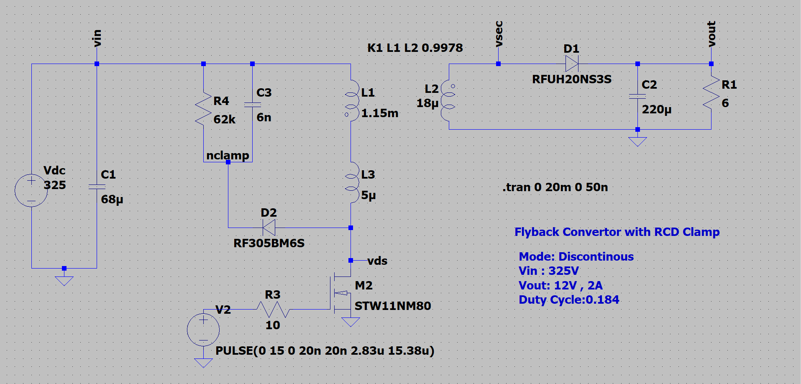
  

## Design 
### Modes Of Operation
There are three possible modes of operation
1- Continous Conduction Mode(CCM)
2- Boundary Conduction Mode(BCM)
3- Discontinous Conduction Mode(DCM)

The flyback convertor here is designed for operation in Discontinuous conduction mode.

### GENERAL DESIGN 

### COUPLED INDUCTOR DESIGN 

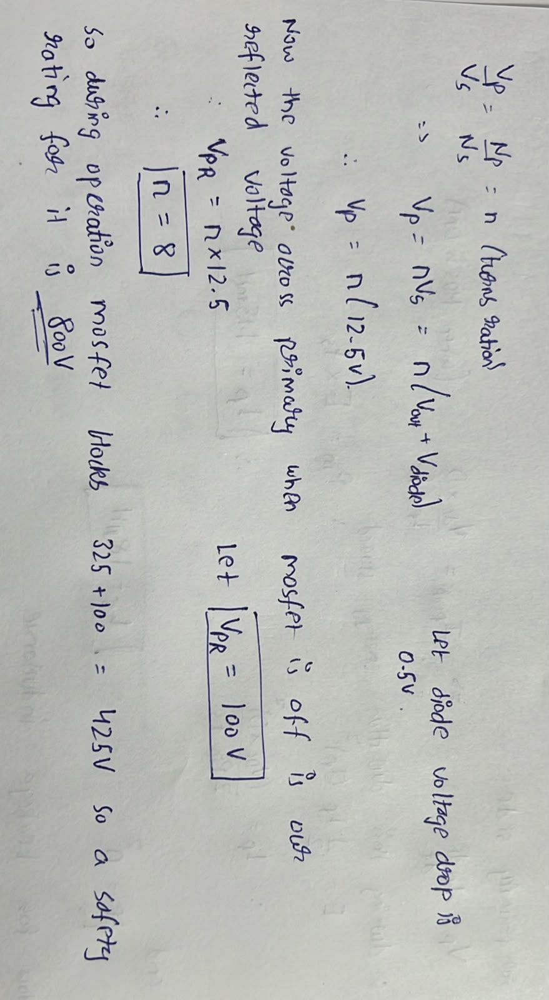

### DCM CONDITION 

### INDUCTANCE DESIGN 

### CAPACITOR DESIGN 

### RCD CLAMP DESIGN

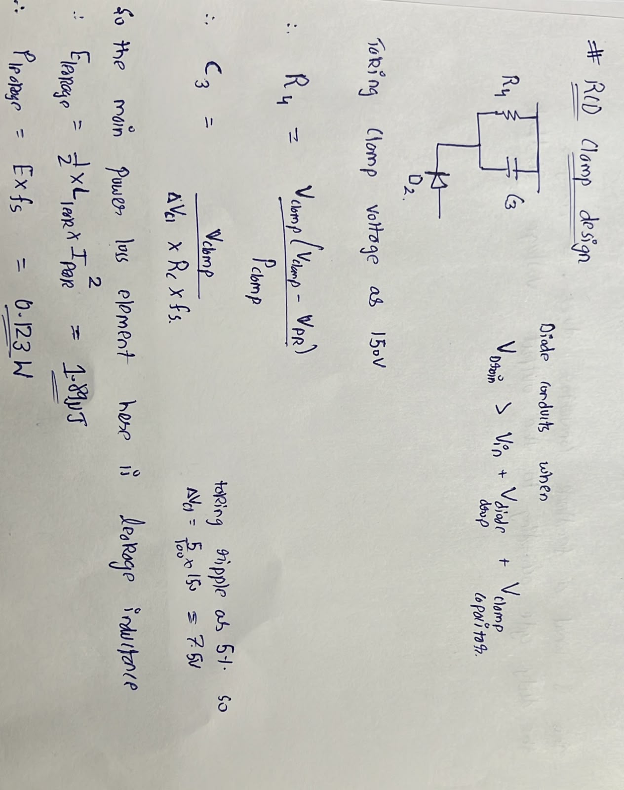

## TUNNING
After running simulation with design elements the output voltage is found somewhere between 10-11V which is lesser then the required target ( incurring all the losses). So a open loop convertor is unregulated and can give voltages that are off the target.

This is manual calibration and is done to match the design target.

## SIMULATION RESULTS
The following results are obtained after the simulation. Here the left hand side is results for circuit with RCD clamp and right hand side show results without one.

### PRIMARY SIDE 

  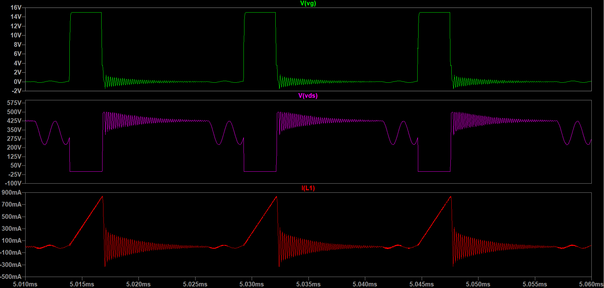
  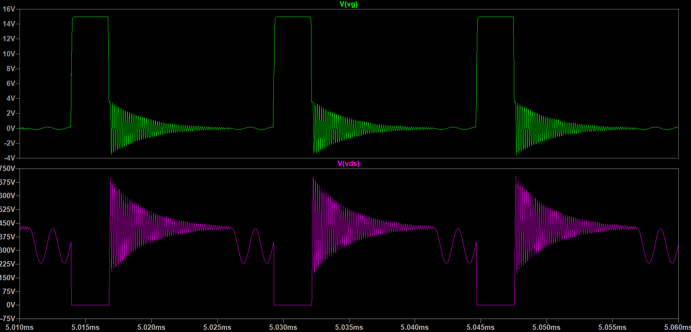

Without clamp the MOSFET drain voltage experiences a larger voltage spike during turn off this is due to energy stored in transformer leakage inductance that oscillates with drain capacitance. By applying clamp these spikes are reduced as clamp dissipate this energy through its resistance and thus protect MOSFET against excessive voltage stress.

### SECONDARY SIDE

  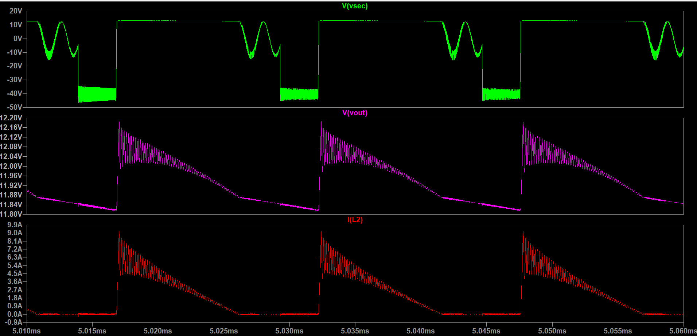
  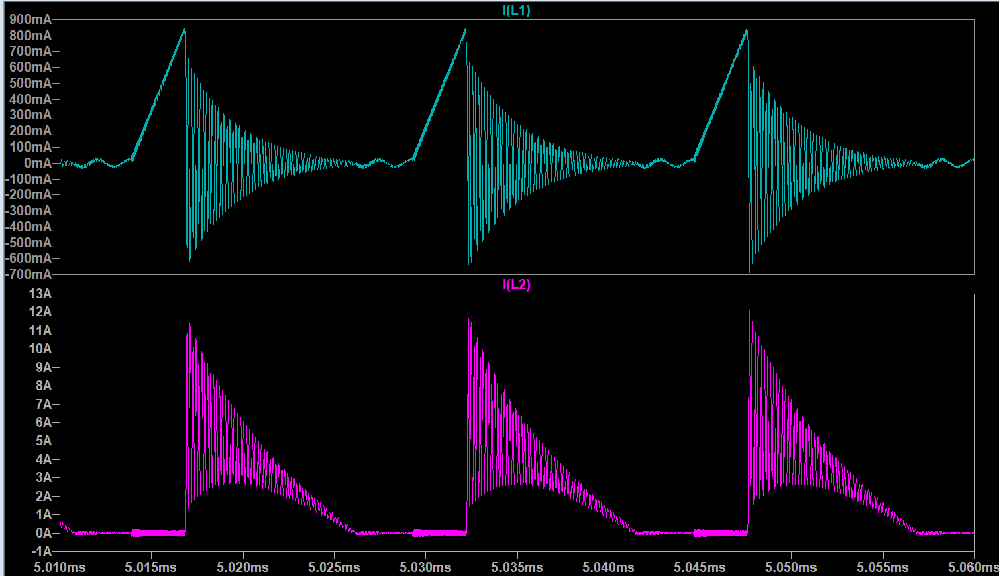

Without clamp there is much more ringing in primary and secondary side current. By applying clamp ringing are reduced and this reduce rms stress on diode and capacitor with less conduction losses.

### MOSFET SWITCHING LOSSES

  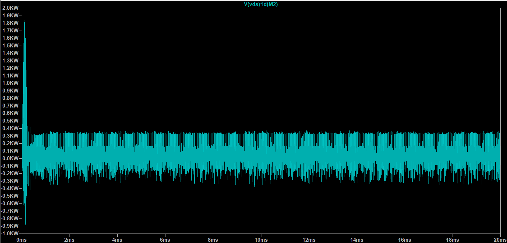
  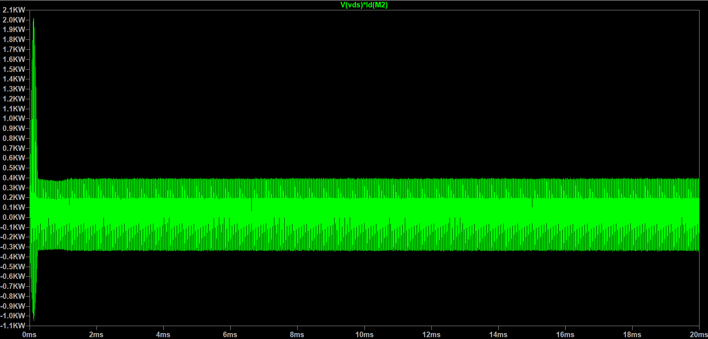

These are instantaneous switching loss in MOSFET. With clamp the Vds overshoot and reduced and thus reduce instantaneous switching losses. 

### OUTPUT POWER 

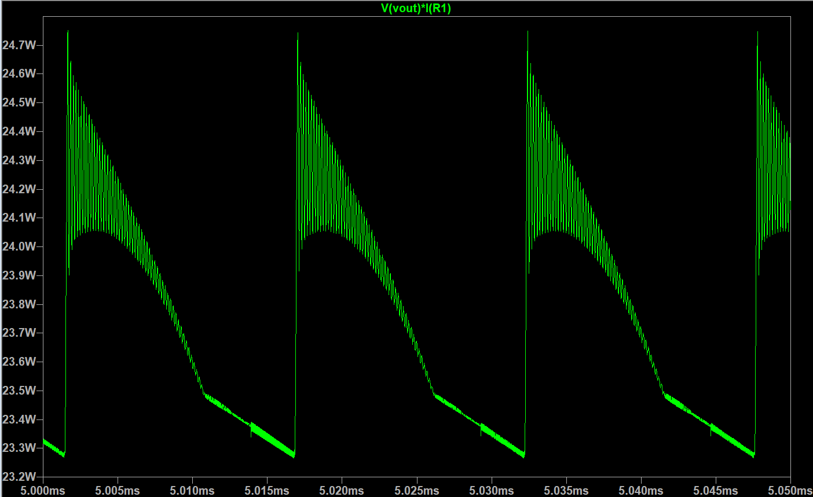

These simulation results show that RCD clamp effectively suppresses the voltage spikes caused by transformer leakage inductance and reduces MOSFET voltage stress.

## With vs Without RCD Clamp: Results
All values are measured over one steady-state switching period (5.01388 ms to 5.02926 ms).

### Power and efficiency

| Parameter | With clamp | Without clamp | Change |
| :--- | ---: | ---: | ---: |
| Input power (avg) | 26.92 W | 27.09 W | -0.6 % |
| Output power (avg) | 23.75 W | 23.88 W | -0.5 % |
| Total loss | 3.18 W | 3.21 W | -0.9 % |
| Input power (inst. peak) | 271 W | 275 W | -1.5 % |
| Output power (inst. peak) | 24.7 W | 25.3 W | -2.4 % |

### Currents

| Parameter | With clamp | Without clamp | Change |
| :--- | ---: | ---: | ---: |
| Primary I(L1), avg | 0.0856 A | 0.0833 A | +2.8 % |
| Primary I(L1), peak | 0.841 A | 0.845 A | -0.5 % |
| Secondary I(L2), avg | 1.989 A | 1.995 A | -0.3 % |
| Secondary I(L2), peak | 9.19 A | 11.96 A | -23.2 % |
| D1 current, RMS | 3.00 A | 3.18 A | -5.7 % |
| D1 current, peak | 9.19 A | 11.96 A | -23.2 % |
| MOSFET drain current, peak | 0.835 A | 0.845 A | -1.2 % |

### Voltages

| Parameter | With clamp | Without clamp | Change |
| :--- | ---: | ---: | ---: |
| Vout, avg | 11.94 V | 11.97 V | -0.3 % |
| Vout ripple (pk-pk) | 0.370 V | 0.482 V | -23.2 % |
| MOSFET Vds, peak | 499 V | 699 V | -28.6 % |
| Vsec, max | +13.3 V | +13.4 V | -0.7 % |
| Vsec, min | -46.6 V | -53.7 V | -13.2 % |

### MOSFET loss

| Parameter | With clamp | Without clamp | Change |
| :--- | ---: | ---: | ---: |
| Average loss | 0.563 W | 0.958 W | -41.2 % |

### Clamp 

| Parameter | Value |
| :--- | ---: |
| R4 loss, avg / peak | 0.460 W / 0.484 W |
| D2 reverse voltage, peak | 491 V |

## STARTUP TRANSIENTS
During the initial start of convertor the output capacitor is initially uncharged. When MOSFET switching operation begins initial surges are observed. This happens as we applied the complete duty-cycle altogether and due to this the output capacitor charges demanding high current that cause these surges.

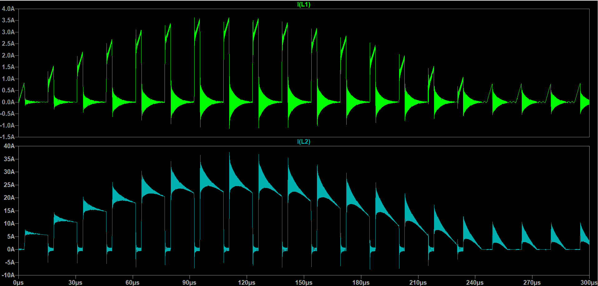

